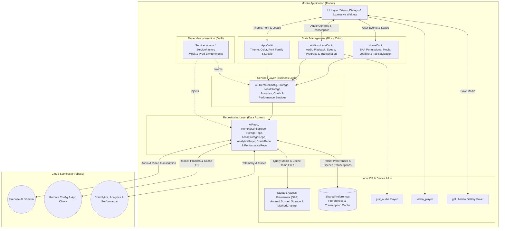

# Ghost Play

[](https://github.com/Piero16301/Ghost_Play/actions/workflows/beta.yaml?query=branch%3Adev)
[](https://codecov.io/gh/Piero16301/Ghost_Play/branch/dev)
[](https://opensource.org/licenses/MIT)
[](https://buymeacoffee.com/sanjuanpamk)

Welcome to the comprehensive documentation for the **Ghost Play** application. This guide covers the project architecture, directory structure, core services, feature modules, AI transcription pipeline, and testing setup for managing WhatsApp voice notes, status media, circular video notes, and user preferences using Android Storage Access Framework (SAF), Material 3 Expressive UI (`expressive_kit`), local caching, and Firebase services.

---

## 📑 Table of Contents

1. [Architecture](#%EF%B8%8F-architecture)
2. [Project Directory Structure](#-project-directory-structure)
3. [App Core (`lib/app`)](#app-core-libapp)
   - [State Management](#1-state-management)
   - [Global Utilities & Router](#2-global-utilities--router)
   - [Repositories & Services Layer](#3-repositories--services-layer)
   - [UI Layer (View & Widgets)](#4-ui-layer-view--widgets)
4. [Feature Modules](#feature-modules)
   - [Home (`lib/home`)](#41-home-libhome)
     - [Audios Home (`audios_home`)](#audios-home-audios_home)
     - [States Home (`states_home`)](#states-home-states_home)
     - [Videos Home (`videos_home`)](#videos-home-videos_home)
   - [Settings (`lib/settings`)](#42-settings-libsettings)
5. [Localization (`lib/l10n`)](#localization-libl10n)
6. [Bootstrap & Entrypoint](#bootstrap--entrypoint)
7. [Packages & Data Models](#packages--data-models)
8. [Configuration & Testing](#configuration--testing)

---

# 🏗️ Architecture



- **UI Layer**: Built with Material 3 Expressive components (`expressive_kit` + `material_ui`), featuring a keep-alive tabbed home dashboard, modal bottom sheet audio player with Markdown transcription card, WhatsApp statuses gallery, circular video note player with Markdown transcription, and customizable settings.
- **State (Bloc/Cubit)**:
  - `AppCubit`: Manages global preferences (theme mode, accent color, font family, and locale) and syncs custom keys to Crashlytics.
  - `HomeCubit`: Manages bottom navigation (`PageView`), SAF directory permissions, recency week filters, and loads audios, statuses, and video notes.
  - `AudiosHomeCubit`: Coordinates `just_audio` playback streams, speed cycling (`1x`, `1.5x`, `2x`), seeking, error reporting, and AI voice-note transcription state.
- **AI Transcription & Caching**:
  - `AiService` transcribes `.opus` voice notes (`audio/ogg`) and `.mp4` video notes (`video/mp4`) via `FirebaseAiRepository` (`firebase_ai` / Gemini) using model names, system instructions, and prompts fetched from `RemoteConfigService`.
  - Transcriptions are cached per file in `SharedPreferences` (`__transcription__<fileName>`) as JSON (`TranscriptionMetadata`: `text` + `timestamp`), avoiding duplicate AI calls unless regenerated (`forceRefresh: true`).
  - Expired transcriptions older than `maxDaysSavedTranscriptions` (configured via Remote Config) are automatically cleaned up on startup.
  - Temporary media files copied for playback or transcription are deleted automatically when no longer needed.
- **Services & Repositories**: Follows the Repository Pattern with Dependency Injection (`get_it`) supporting `Environment.mock` (bundled sample media under `mocks/`) and `Environment.prod`.
- **Native OS & Scoped Storage**: Uses `saf` (Storage Access Framework) and a native Android `MethodChannel` (`ghostplay/storage`) to read `.opus` voice notes, `.statuses`, and WhatsApp video notes without root access.

---

# 📁 Project Directory Structure

Below is the current file and directory layout under `lib/` and `test/`:

```text
lib/
├── app/                                       # Global application core (shared infrastructure)
│   ├── cubit/                                 # Global application state management
│   │   ├── app_cubit.dart                     # AppCubit: theme, color, font family, and locale
│   │   └── app_state.dart                     # AppState: immutable state model
│   ├── global/                                # Global utilities, DI, and router
│   │   ├── app_dependencies.dart              # GetIt service locator & ServiceFactory (mock/prod)
│   │   ├── app_functions.dart                 # Formatting utilities & SnackBar helper
│   │   ├── app_router.dart                    # GoRouter configuration & AppRoute enum
│   │   ├── app_variables.dart                 # Global constants, timeouts & default options
│   │   └── global.dart                        # Barrel file
│   ├── models/                                # Global domain & transfer models
│   │   ├── app_route_observer.dart            # NavigatorObserver logging screen views to Analytics
│   │   ├── audio_metadata.dart                # Metadata for .opus voice notes
│   │   ├── models.dart                        # Barrel file
│   │   ├── multimedia_metadata.dart           # Unified metadata for statuses & video notes
│   │   ├── prompt_part.dart                   # Text & inline file prompt parts for Gemini
│   │   └── transcription_metadata.dart        # Cached transcription payload (text + timestamp)
│   ├── repositories/                          # Data access layer (Firebase, Storage, SharedPrefs)
│   │   ├── ai_repository.dart                 # Firebase AI (Gemini) & mock repository
│   │   ├── analytics_repository.dart          # Firebase Analytics wrapper
│   │   ├── crash_repository.dart              # Firebase Crashlytics wrapper
│   │   ├── local_storage_repository.dart      # SharedPreferences preferences & transcription cache
│   │   ├── performance_repository.dart        # Firebase Performance wrapper
│   │   ├── remote_config_repository.dart      # Firebase Remote Config wrapper
│   │   ├── repositories.dart                  # Barrel file
│   │   └── storage_repository.dart            # SAF, MethodChannel & mock media storage
│   ├── services/                              # Business logic layer orchestrating repositories
│   │   ├── ai_service.dart                    # Audio/video transcription, caching & telemetry
│   │   ├── analytics_service.dart             # Event tracking & screen analytics
│   │   ├── crash_service.dart                 # Error reporting, logs & custom keys
│   │   ├── local_storage_service.dart         # Preferences, transcription cache & TTL cleanup
│   │   ├── performance_service.dart           # Custom performance traces
│   │   ├── remote_config_service.dart         # Remote Config initialization & config getters
│   │   ├── services.dart                      # Barrel file
│   │   └── storage_service.dart               # Scoped storage, media queries & thumbnail cache
│   ├── view/                                  # Root application UI bootstrap
│   │   ├── app_page.dart                      # Root widget providing AppCubit
│   │   ├── app_view.dart                      # MaterialApp.router, ExpressiveTheme & l10n setup
│   │   └── view.dart                          # Barrel file
│   ├── widgets/                               # Shared UI components
│   │   ├── app_filled_button.dart             # Styled filled action button
│   │   ├── app_outlined_button.dart           # Styled outlined action button
│   │   └── widgets.dart                       # Barrel file
│   └── app.dart                               # App module umbrella barrel file
├── home/                                      # Home module (Main features & tabs)
│   ├── cubit/                                 # Main Home state management
│   │   ├── home_cubit.dart                    # HomeCubit: SAF permissions, media loading & tabs
│   │   └── home_state.dart                    # HomeState: active tab, filters & media lists
│   ├── pages/                                 # Tab sub-views
│   │   ├── audios_home/                       # Voice Notes tab
│   │   │   ├── cubit/                         # AudiosHomeCubit: playback & audio transcription
│   │   │   │   ├── audios_home_cubit.dart
│   │   │   │   └── audios_home_state.dart
│   │   │   ├── view/                          # Audios views & modal bottom sheet launcher
│   │   │   │   ├── audios_home_page.dart
│   │   │   │   ├── audios_home_view.dart
│   │   │   │   └── view.dart
│   │   │   ├── widgets/                       # Audio player & transcription UI
│   │   │   │   ├── audio_transcription_card.dart # Scrollable Markdown transcription card
│   │   │   │   ├── mini_player.dart           # Compact player with speed, transcribe & seek
│   │   │   │   └── widgets.dart
│   │   │   └── audios_home.dart               # Barrel file
│   │   ├── states_home/                       # Statuses tab
│   │   │   ├── view/
│   │   │   │   ├── states_home_page.dart
│   │   │   │   ├── states_home_view.dart      # Grid view of photo & video statuses
│   │   │   │   └── view.dart
│   │   │   └── states_home.dart               # Barrel file
│   │   ├── videos_home/                       # Video Notes tab
│   │   │   ├── view/
│   │   │   │   ├── videos_home_page.dart
│   │   │   │   ├── videos_home_view.dart      # Grid view of circular video notes + filter
│   │   │   │   └── view.dart
│   │   │   └── videos_home.dart               # Barrel file
│   │   └── pages.dart                         # Barrel file for all home pages
│   ├── view/                                  # Main Home Scaffold
│   │   ├── home_page.dart                     # Provider injector for HomeCubit
│   │   ├── home_view.dart                     # Scaffold with keep-alive PageView & NavigationBar
│   │   └── view.dart                          # Barrel file
│   ├── widgets/                               # Shared Home dialogs & media controls
│   │   ├── multimedia_preview_dialog.dart     # Preview & gallery save dialog for statuses
│   │   ├── transcription_markdown.dart        # Theme-aware Markdown renderer for transcriptions
│   │   ├── video_note_preview_dialog.dart     # Circular video note player, transcription & save
│   │   ├── video_progress_bar.dart            # Reusable VideoControlsBar & VideoProgressBar
│   │   └── widgets.dart                       # Barrel file
│   └── home.dart                              # Home module umbrella barrel file
├── l10n/                                      # Localization module (6 languages)
│   ├── arb/                                   # ARB source files (de, en, es, fr, it, pt)
│   ├── gen/                                   # Auto-generated AppLocalizations delegates
│   └── l10n.dart                              # Localization exports
├── settings/                                  # Settings module (Preferences & App Info)
│   ├── view/
│   │   ├── settings_page.dart                 # Settings entry point
│   │   ├── settings_view.dart                 # Theme, color, font family & language modals
│   │   └── view.dart                          # Barrel file
│   ├── widgets/
│   │   ├── settings_app_specs.dart            # App version, build number & last update date
│   │   └── widgets.dart                       # Barrel file
│   └── settings.dart                          # Settings module umbrella barrel file
├── bootstrap.dart                             # AppBlocObserver & global error handlers
├── firebase_options.dart                      # Auto-generated Firebase configuration
└── main.dart                                  # Entrypoint (Firebase, App Check, DI & bootstrap)
```

```text
test/                                          # Unit & widget test suite (315+ tests)
├── app/                                       # Core tests (cubit, global, models, repos, services, view, widgets)
├── helpers/                                   # Shared test utilities (mocks.dart, pump_app.dart, service_locator.dart)
├── home/                                      # Home tests (cubit, view, audios_home, states_home, videos_home, dialogs)
├── l10n/                                      # Localization tests
└── settings/                                  # Settings page & view tests
```

---

## App Core (`lib/app`)

### 1. State Management

| File | Role |
|------|------|
| **lib/app/cubit/app_cubit.dart** | Manages **global app state**: theme mode (`system`/`light`/`dark`), base accent color, font family (`ExpressiveFonts`), and locale. Syncs preferences with `LocalStorageService`, logs Analytics events, and sets Crashlytics custom keys. |
| **lib/app/cubit/app_state.dart** | Immutable Equatable state holding `language`, `theme`, `baseColor`, and `fontFamily`. |

---

### 2. Global Utilities & Router

| File | Role |
|------|------|
| **lib/app/global/app_dependencies.dart** | Configures `GetIt` service locator (`ServiceFactory`) for `Environment.mock` and `Environment.prod`. |
| **lib/app/global/app_functions.dart** | Common helpers such as file name truncation and styled `SnackBar` presentation. |
| **lib/app/global/app_router.dart** | Declares `GoRouter` navigation graph (`AppRoute.home` at `/`, `AppRoute.settings` at `/settings`) with `AppRouteObserver` for screen analytics. |
| **lib/app/global/app_variables.dart** | Application-wide constants, animation/timeout durations (`timeoutDuration`, `aiTimeoutDuration`, Remote Config fetch settings), week filter options, and asset paths. |

---

### 3. Repositories & Services Layer

Employs the Repository Pattern wired through `GetIt`. Business orchestration, caching, and telemetry live in Services; SDK wrappers and native platform integrations live in Repositories.

| Layer | Responsibility | Key Files |
|-------|----------------|-----------|
| **Repositories** (`lib/app/repositories/`) | Low-level Firebase SDKs, SharedPreferences persistence, SAF / `MethodChannel` storage, and mock implementations. | `ai_repository.dart`, `analytics_repository.dart`, `crash_repository.dart`, `local_storage_repository.dart`, `performance_repository.dart`, `remote_config_repository.dart`, `storage_repository.dart` |
| **Services** (`lib/app/services/`) | High-level business flows orchestrating repositories and telemetry, consumed by Cubits and Views. | `ai_service.dart`, `analytics_service.dart`, `crash_service.dart`, `local_storage_service.dart`, `performance_service.dart`, `remote_config_service.dart`, `storage_service.dart` |

**Key Capabilities:**
- **AI Transcription (`AiService`)**: Extracts transcriptions from `.opus` voice notes (`audio/ogg`) and `.mp4` video notes (`video/mp4`) via Gemini (`FirebaseAiRepository`), checks/updates local cache (`cache_hit` vs `remote_call` analytics), cleans up temporary `.opus` files, traces latency, and reports failures to Crashlytics.
- **Remote Config (`RemoteConfigService`)**: Initializes and serves `geminiModelName`, `geminiSystemInstruction`, `geminiPromptExtractAudio`, `geminiPromptExtractVideo`, and `maxDaysSavedTranscriptions`, with performance tracing and Crashlytics error handling.
- **Local Storage (`LocalStorageService`)**: Persists theme, accent color, font family, locale, and per-file `TranscriptionMetadata` JSON entries with traced TTL cleanup (`clearOldTranscriptions`).
- **Media Storage (`StorageService`)**: Queries Android scoped storage via SAF / `MethodChannel`, caches temporary files for playback/transcription, and maintains an in-memory thumbnail cache with `thumbnail_generation_latency` traces and Crashlytics error reporting.
- **Telemetry (`AnalyticsService`, `CrashService`, `PerformanceService`)**: Tracks user interactions, screen transitions, custom traces, breadcrumbs, custom keys, and non-fatal/fatal crashes.

---

### 4. UI Layer (View & Widgets)

| File | Role |
|------|------|
| **lib/app/view/app_page.dart** | Root widget providing `AppCubit` and triggering `initialLoad()`. |
| **lib/app/view/app_view.dart** | Configures `MaterialApp.router` with `ExpressiveTheme.light` / `ExpressiveTheme.dark`, dynamic font family, and localization delegates. |
| **lib/app/widgets/app_filled_button.dart** | Standard filled action button. |
| **lib/app/widgets/app_outlined_button.dart** | Standard outlined action button. |

---

## Feature Modules

### 4.1 Home (`lib/home`)

Coordinated by `HomeCubit` with three keep-alive tabs inside a `PageView` and `ExpressiveNavigationBar`:

- **Home Scaffold (`home_page.dart`, `home_view.dart`)**:
  - Switches smoothly between **Voice Notes**, **States**, and **Video Notes** while preserving tab state (`_KeepAliveTab`).
  - Hosts the app bar settings button (`/settings`).
  - Prompts for SAF storage permission when not yet granted and loads all three media categories in parallel.

#### Audios Home (`audios_home`)
- **Location**: `lib/home/pages/audios_home/`
- **Cubit**: `AudiosHomeCubit` (`audios_home_cubit.dart`, `audios_home_state.dart`)
- **Key Features**:
  - Lists `.opus` voice notes with formatted duration, date, and recency week filter.
  - Opens a dark-scrim modal bottom sheet (`_AudioPlayerSheetLauncher`) displaying `AudioTranscriptionCard` above `MiniPlayer`; tapping outside dismisses and closes the player.
  - Full `just_audio` playback controls: play, pause, resume, seek slider, and speed cycling (`1x`, `1.5x`, `2x`).
  - On-demand AI transcription with Markdown rendering (`TranscriptionMarkdown`), local caching, and **Regenerate** (`forceRefresh: true`).

#### States Home (`states_home`)
- **Location**: `lib/home/pages/states_home/`
- **Key Features**:
  - Displays cached WhatsApp image and video statuses in a responsive 2-column grid with cached thumbnails.
  - Tapping an item opens `MultimediaPreviewDialog` with `VideoControlsBar` for videos, gallery export via `gal`, and automatic temporary file cleanup on dispose.

#### Videos Home (`videos_home`)
- **Location**: `lib/home/pages/videos_home/`
- **Key Features**:
  - Displays WhatsApp circular video notes in a 2-column grid with recency week filtering and cached thumbnails.
  - Tapping a video note opens `VideoNotePreviewDialog` featuring a circular video player (`_CircularVideoPlayer`), `VideoControlsBar` (play/pause, seek, mute/unmute, transcribe), scrollable Markdown transcription (`TranscriptionMarkdown`) with **Regenerate**, gallery export via `gal`, and automatic temporary file cleanup on dispose.

---

### 4.2 Settings (`lib/settings`)

- **Location**: `lib/settings/`
- **View**: `SettingsPage`, `SettingsView`
- **Widgets**: `SettingsAppSpecs`
- **Key Features**:
  - **Appearance**: Theme mode (System, Light, Dark), accent color palette (`ExpressiveColors`), and font family (`ExpressiveFonts`) via modal bottom sheets.
  - **Language**: Switch locale across 6 supported languages with country flags.
  - **App Information**: Displays app version, build number, and last update date via `package_info_plus`.

---

## Localization (`lib/l10n`)

The application supports **6 languages** with compile-time type safety:

| Language | ARB Source File |
|----------|-----------------|
| **English** (Default) | `lib/l10n/arb/app_en.arb` |
| **Spanish** | `lib/l10n/arb/app_es.arb` |
| **German** | `lib/l10n/arb/app_de.arb` |
| **French** | `lib/l10n/arb/app_fr.arb` |
| **Italian** | `lib/l10n/arb/app_it.arb` |
| **Portuguese** | `lib/l10n/arb/app_pt.arb` |

- Generated delegates reside under `lib/l10n/gen/`.

---

## Bootstrap & Entrypoint

| File | Role |
|------|------|
| **lib/main.dart** | Initializes `WidgetsFlutterBinding`, Firebase, and `setupServiceLocator()`. Runs `FirebaseAppCheck.activate`, `LocalStorageService.initialize`, and `RemoteConfigService.initialize` in parallel, cleans expired cached transcriptions (`clearOldTranscriptions`), and launches `bootstrap(() => const AppPage())`. |
| **lib/bootstrap.dart** | Configures `AppBlocObserver`, `FlutterError.onError`, and `PlatformDispatcher.instance.onError` to forward uncaught errors to `CrashService`. |
| **lib/firebase_options.dart** | Auto-generated Firebase configuration per platform. |

---

## Packages & Data Models

### Key Data Models

- **`lib/app/models/audio_metadata.dart`**: File URI, name, date, duration, and formatted size for `.opus` voice notes.
- **`lib/app/models/multimedia_metadata.dart`**: Unified model for WhatsApp statuses and video notes (`uri`, `name`, `date`, `sizeBytes`, `isVideo`, `videoDurationMs`).
- **`lib/app/models/prompt_part.dart`**: Typed prompt parts (`PromptPart.text` and `PromptPart.file`) passed to `AiRepository`.
- **`lib/app/models/transcription_metadata.dart`**: Serializable transcription cache entry (`text`, `timestamp`, `toJson` / `fromJson`).
- **`lib/app/models/app_route_observer.dart`**: Custom `NavigatorObserver` logging screen transitions to Firebase Analytics.

### Core Dependencies

- **SDK**: Dart `>=3.14.0`, Flutter `>=3.50.0`.
- **UI & Design System**: `expressive_kit`, `material_ui`, `hugeicons`, `country_flags`, `flutter_markdown_plus`.
- **State Management & DI**: `bloc`, `flutter_bloc`, `equatable`, `get_it`.
- **Navigation**: `go_router`.
- **AI & Firebase**: `firebase_core`, `firebase_ai`, `firebase_remote_config`, `firebase_app_check`, `firebase_crashlytics`, `firebase_analytics`, `firebase_performance`.
- **Storage & Media**: `saf`, `shared_preferences`, `just_audio`, `video_player`, `gal`, `package_info_plus`, `intl`.

---

## Configuration & Testing

### Code Quality
- Enforces strict linting standards with **`very_good_analysis`** and **`bloc_lint`**.
- Formatted using `fvm dart format`.
- Clean static analysis with `fvm flutter analyze`.

### Testing Suite
- Comprehensive unit and widget tests (`315+` tests) built with `mocktail` and `bloc_test`, with 100% line coverage across core cubits, models, repositories, and services.
- Run tests and coverage with:
  ```bash
  fvm flutter test --coverage
  genhtml coverage/lcov.info -o coverage/html
  ```

---

> **Enjoy building and extending the Ghost Play app!**
